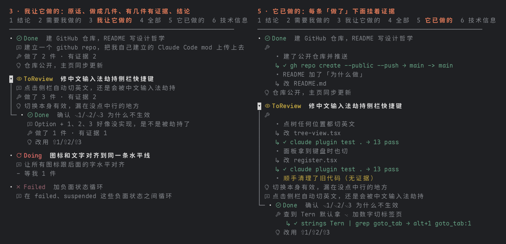
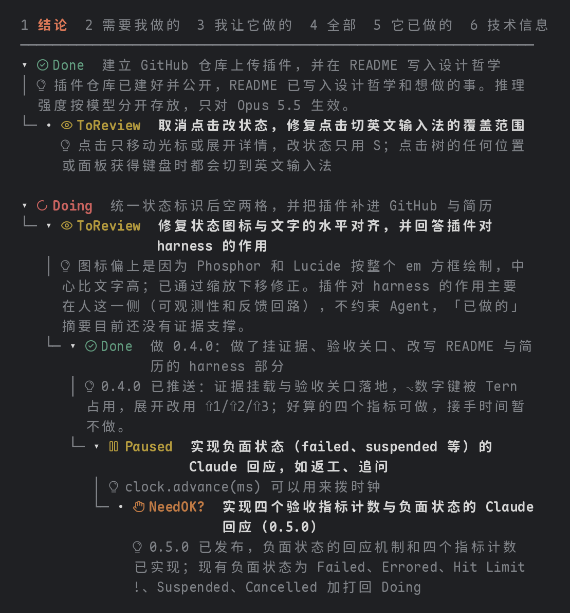
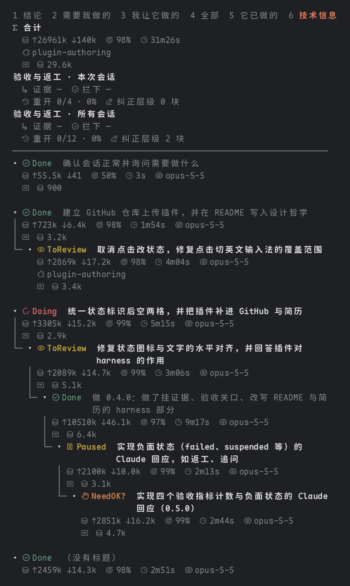

# Outline Sidebar

Claude Code 的 mod：把一次会话整理成 Logseq 式的可折叠大纲侧栏。一轮对话是一块，顺着同一个话题深入就成为子块，换了话题就是新的顶层块。层级由 AI 出初稿，你在侧栏里手动纠正。

> **目前适配 Claude Code CLI（终端）。** Desktop 版和 VS Code 里也能打开，但会退回成普通按钮，键盘操作、图标、中文排版都没调过，Desktop 版后面再做。

它是我在 harness 工程上的一次实践。大多数 harness 管的是 Agent 那一侧：给它什么上下文、什么工具、怎么验证它的产出。这个 mod 管的是人那一侧：人怎么看清 Agent 做了什么，人的判断又怎么可靠地回到 Agent 那里。



> 左：3 号视图「我让它做的」，每件事带着我的原话、做成了几件、有几件有证据、结论。右：5 号视图「它已做的」，每条「做了」下面挂着证据；挂不上证据的标黄。图是用 mod 自己的大纲代码按一段示例会话生成的。

## 再看两个视图

用的是我开发这个 mod 那场会话的真实大纲，按终端里的排版画出来（正在跑的那一轮没放进来）。

1 号视图「结论」：每一轮定下来的结论，顺着层级排；没有结论的块变暗，只留着当上下文。



6 号视图「技术信息」：顶上是整场会话的合计和验收指标（本次会话、所有会话各一遍），下面每一轮的用量、缓存命中率、耗时、模型、用到的技能，以及大纲自己总结花掉的 token。截图里证据和拦下都是「—」，因为这些块是在加证据功能之前做的。



## 为什么做这个

AI 时代，最珍贵的是人类完整的、不被切分的注意力（undivided attention）。

人在知识领域已经从农耕时代进入了自动化时代，坐上了大型连排拖拉机。活儿大多交给 AI 去干，人要做的是 review：判断它做得对不对、接下来往哪儿走。这时候人的注意力成了瓶颈，守住自己的注意力就成了关键。光有注意力还不够，还要有好的 harness 来帮你 review。

更严格地说，需要的是**装着问题的注意力**：脑子里同时持有整个问题的状态，知道什么算对、什么已经试过、哪里最可能出错。这个状态建起来要二三十分钟，毁掉只要三秒，重来的成本也不成线性关系。真正被切碎的是这种装载状态，并非时间。

和 Claude Code 的一场长会话，就是最容易把这种状态切碎的地方。对话是一条只往下长的流，结论、要我拍板的事、交代出去的活、已经做完的事、技术细节全搅在一起。想找回刚才定了什么、还有什么在等我，只能往上翻，每翻一次都在消耗那份装载状态。没有好的 harness engineering，认知债务就会越积越重。

## 它在 harness 里做什么

它在 harness 里实际承担两个角色：

1. **可观测性**：结论、要我拍板的事、交代出去的活、它做完的事，分开显示。不用在一条流里往上翻。这直接对着人的瓶颈：review 时的注意力。
2. **结构化的反馈回路**：在侧栏改的状态会变成结构化信息，在你发下一条消息时传回给 Claude。比如把「确认仓库是否公开」标成 Done，Claude 收到的是一条明确的状态变更，用不着再读一段话去猜。人的判断用固定格式回到 Agent 的上下文，这是比较硬的 harness 设计，比在聊天里说一句可靠。

围绕这两个角色，又加了几样东西，让 review 看的是证据而不只是 AI 写的摘要，让验收的结论能推动下一步：

- **「做了」挂证据**：每一轮里改了哪些文件、跑了哪些命令、命令成没成、输出的最后一行，都直接从工具调用里记下来，不经过模型。总结时，模型只能从这些记录里挑出能证明某件事的那几条，挑不出就标「无证据」。
- **验收关口**：状态是 ToReview 的块，要改成 Done，得先展开详情看过证据。没看过就按 S，这一下只会替你展开证据、不改状态，看完再按一次才算通过。通过时会告诉 Claude「用户看过证据后验收」，有哪几条「做了」没有证据，也一并说出来。
- **验收没通过，Claude 接着回应**：⇧ 加首字母直接标成对应的状态，N 在它们之间从轻到重循环。待验收的块被标成这些状态，或者用 S 打回 Doing，停手 4 秒后（留时间换到想要的状态）mod 会替你发一条消息，按最终状态告诉 Claude 怎么接：

  | 键 | 状态 | Claude 怎么接 |
  |---|---|---|
  | ⇧R | Rework（要改） | 方向对、细节要改：先复述要改哪几处，你确认了再动手，改完再交给你验收 |
  | ⇧U | Unclear?（没看懂） | 先不改代码，拿这一轮的改动和命令结果解释清楚：做了什么、为什么、怎么验证的 |
  | ⇧F | Failed | 对照改动和命令结果找原因：原因清楚就返工，改完再交给你验收；拿不准就先追问你 |
  | ⇧E | Errored | 排查报错、修好再继续；缺信息就追问你 |
  | ⇧L | Hit Limit! | 停下，说明卡在哪个上限、什么时候能继续，不反复重试 |
  | ⇧S | Suspended | 不再动它，记下做到哪、还差什么，方便以后接上 |
  | ⇧C | Cancelled | 停下；已经改了文件就列出来，问你要不要撤回 |
  | S | Doing（打回） | 说清还差什么，接着做完 |

  4 秒内改回 Done 就不发。一次打回好几件时，消息里还会让 Claude 把互不相干、不改同一批文件的几件交给子代理并行做，碰同一批文件的按顺序来；子代理在大纲里显示成那一轮下面的子块。
- **指标**：6 号视图「技术信息」底部，按本次会话和所有会话各算一遍：证据覆盖率（「做了」里有证据的比例）、验收拦下率（验收时没让通过的比例）、返工率（标了 Done 又被重新打开的比例）、手动纠正过层级的块数。用来看这套 harness 到底有没有拦下东西、AI 的说法有多少能落到证据上。

被打断以后，最快把注意力装回来的办法是看 3 号视图「我让它做的」：我当时原话怎么说的、它做成了几件、有几件有证据、还有几件在等我、结论是什么，一屏扫完。

它不管的也写清楚：它不约束 Agent，护栏、权限、测试这些控制层不归它管；它主要看单场会话，跨会话只有 `/agenda` 汇总还没办完的事。

## 为终端和中文输入法做的优化

现在主要优化的是 Claude Code 的**终端版**：键盘操作、图标字体、中文排版都是照终端调的。桌面版和 VS Code 里也能用，但会退回成普通按钮，比较简陋，客户端版本后面再优化。

终端里，键盘快捷键碰上中文输入法很麻烦：J/K、T、S 这些字母键会先被输入法拿去组字，到不了侧栏，按下去只会弹出候选框。国内用户基本都开着拼音或鼠须管，所以这里专门处理了几件事：

- **点进侧栏自动切英文**：点侧栏任何地方（大纲树、视图栏、工具栏）都会把输入法切到英文键盘；回到对话框敲第一个键时切回你原来的输入法，这个键只用来切换，不会打进对话框。用的是 macOS 的输入源接口，不管原来开的是系统拼音还是鼠须管（Rime）这类第三方输入法，都是直接切到 U.S. 键盘
- **不切也能用**：方向键、回车、空格、数字、⌫ 不经过输入法，只用这几个键也能做完所有操作（移动、折叠、⏎ 菜单里改状态、聚焦、导出）
- **中文按格子宽度折行**：中文占两格，可以在任何字之间断开；英文单词不拆。窄侧栏里也不会把一行字挤乱
- **图标用自制字体**：状态和字段图标打包成两个字体，放在 Unicode 补充私用区 B，不和中文字体抢码位；图标按文字中心对齐过，和后面的字在同一条水平线上
- **避开终端自己的快捷键**：展开层级用 ⇧1 / ⇧2 / ⇧3。Tern、iTerm 这类终端默认拿 ⌥ 加数字切标签页，按键到不了 Claude Code

## 用法

### 命令

- `/outline [视图]`：打开大纲面板。视图有 conclusions、me、asks、all、done、tech
- `/outline export [视图] [路径]`：把视图导出成 Markdown 文件
- `/agenda`：所有会话里需要我做、还没办完的事

### 视图（数字键）

| 键 | 视图 | 看什么 |
|---|---|---|
| `1` | 结论 | 每一轮定下来的结论 |
| `2` | 需要我做的 | 停下来等我确认、选择、动手的事，每一条可以单独改状态 |
| `3` | 我让它做的 | 我交代的每件事：原话、做成几件、有几件有证据、还有几件等我、结论 |
| `4` | 全部 | 整棵大纲 |
| `5` | 它已做的 | 每条「做了」和挂在下面的证据 |
| `6` | 技术信息 | 用量、缓存命中率、耗时、模型、技能、MCP、子代理；底部是验收指标 |

数字键的顺序可以在 `/config` 的 `views` 字段里改。

### 字母键

先点一下大纲树，键盘就交给侧栏了。

| 键 | 作用 |
|---|---|
| `J` / `K` | 光标下移 / 上移（↓ / ↑ 也行） |
| `T` | 在子块上按：折起它的母块，光标跳到母块；再按继续往上折一层。顶层块上按：开合它自己的子块 |
| `E` | 和 T 反过来：展开光标所在块的子块，光标跳到第一个子块；再按继续往下一层 |
| `D` | 展开 / 收起光标所在块的详情（空格也行）。ToReview 的块展开详情就算看过证据了 |
| `L` / `H` | 缩进 / 反缩进：把这一块挂到上一块下面，或者提回上一层（⌥→ / ⌥← 也行）。手动改过的层级，AI 不会再动 |
| `S` | 切状态：Todo → Doing → Done → Todo；ToReview 按一下是验收通过（要先看过证据）。点击只挪光标，不改状态 |
| `N` | 负面状态循环，从轻到重：Rework → Unclear? → Failed → Errored → Hit Limit! → Suspended → Cancelled。待验收的块标成这些状态，停手 4 秒后交给 Claude 回应 |
| `⇧R` `⇧U` `⇧F` `⇧E` `⇧L` `⇧S` `⇧C` | 直接标成 Rework、Unclear?、Failed、Errored、Hit Limit!、Suspended、Cancelled（取英文首字母；只在终端的树里能用，按钮不分大小写） |
| `O` | 层级循环：只看顶层 → 全部标题 → 全部展开 |
| `Z` | 聚焦：只看光标所在的这一块和它的子块；再按退出 |
| `F` | 正文折叠：把对话里这一轮的消息改成一行摘要，和侧栏里的折叠无关 |
| `W` | 正文全折：除了最新一轮，每一轮都只留一行摘要；再按全部展开 |
| `P` | 刷新进度：正在跑的一轮，让模型写一句做到哪了 |
| `R` | 回顾：用大纲生成一段这场会话的回顾 |
| `G` | 跳转：对话滚到这一块对应的那条消息 |
| `X` | 导出：把当前视图复制成 Markdown |
| `I` | 图例：显示所有状态和字段图标的意思 |

### 其他按键

- `⇧1` / `⇧2` / `⇧3`：整棵大纲展开到第 1 / 2 / 3 层，更深的折起来（没被终端占用的话，⌥1 / ⌥2 / ⌥3 也行）
- `⏎`：弹出菜单，里面有改状态、聚焦、导出等全部操作，只用方向键和回车就能做完
- `←` / `→`：折叠 / 展开光标所在块的子块；`Ctrl+↑` / `Ctrl+↓` 也是折叠和展开
- `⌘/` 或 `Ctrl+/`：和 S 一样切状态
- 键盘分两层：先在视图栏用数字或 ←→ 选视图，⏎ 进入后光标只在这个视图的行里走，⌫ 回视图栏；在树里直接按数字也能换视图
- 进树只能用鼠标点一下（Claude Code 不让按键把键盘交给自绘区域）。Esc 是 Claude Code 自己的，会把键盘整个还给面板，要再点一下树才回来

### 状态

`Todo` `Todo4AI` `Doing` `ToReview` `Rework` `Unclear?` `NeedOK?` `Errored` `Hit Limit!` `Queued` `Delegated` `Paused` `Waiting` `Suspended` `Done` `Failed` `Cancelled`，照 Obsidian 插件 todoseq 的那一套，另加了验收专用的 Rework 和 Unclear?（只给人用，总结的模型不会挑这两个）；按 `I` 看每个图标的意思。

## 安装

在 Claude Code 里运行：

```
/plugin install outline-sidebar --marketplace MatsuriMW/outline-sidebar
```

图标靠 `fonts/` 里的两个字体显示（Phosphor 和 Lucide 的子集，放在 Unicode 补充私用区 B）。终端里要先安装这两个字体，再把它们加进终端字体的回退链；桌面版直接用 SVG，不需要装。字体更新后要重新安装、重开终端才会生效。

图标按 Maple Mono 的文字中心对齐过（`tools/align_icons.py`）。换了别的终端字体、觉得图标偏上或偏下，改脚本开头的 `CENTER` 和 `HEIGHT` 再跑一遍就行。

改了代码后，在 Claude Code 里运行 `/reload-plugins` 生效。
