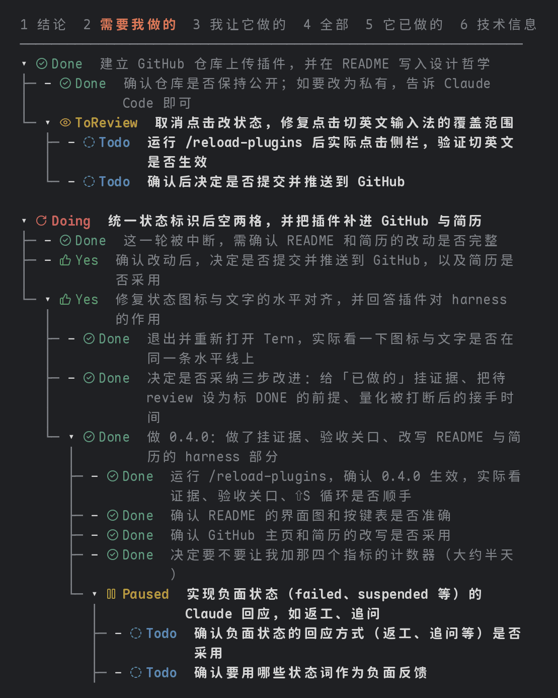
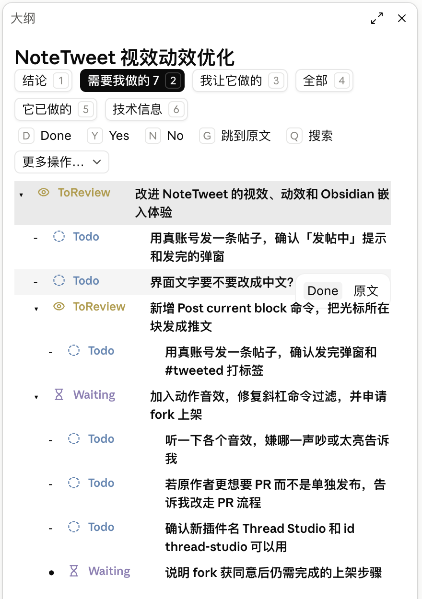
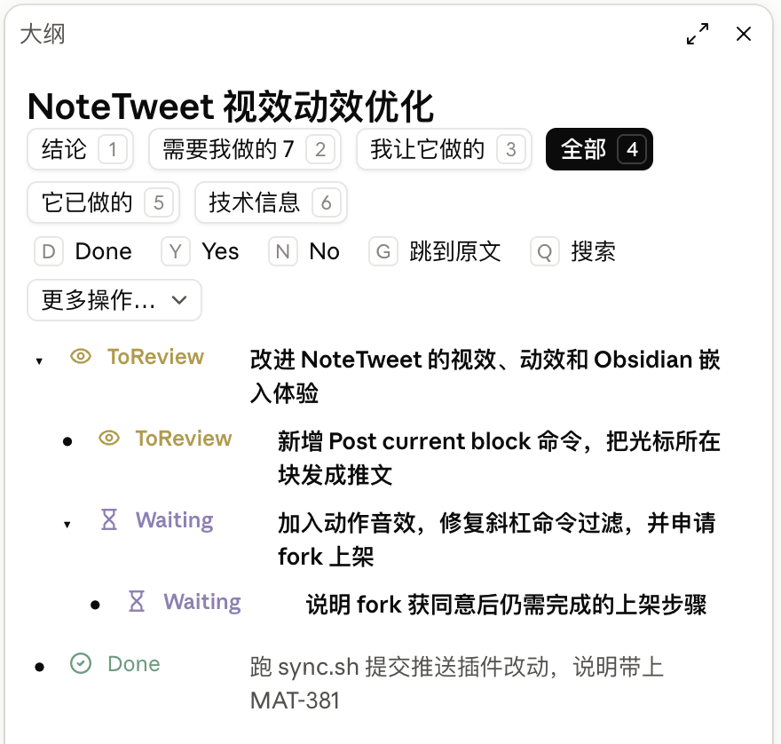

# Outline Sidebar

[English](README.md) | 简体中文

- [为什么做这个](#为什么做这个)
- [它是什么](#它是什么)
- [再看几个视图](#再看几个视图)
- [它在 harness 里做什么](#它在-harness-里做什么)
- [为终端和中文输入法做的优化](#为终端和中文输入法做的优化)
- [用法](#用法)
  - [推荐用法：以 1 号视图为主界面](#推荐用法以-1-号视图为主界面)
  - [命令](#命令)
  - [视图（数字键）](#视图数字键)
  - [回复与验收](#回复与验收)
  - [移动与折叠](#移动与折叠)
  - [其他](#其他)
  - [任务状态](#任务状态)
- [安装](#安装)
- [它会运行、发送、读写什么](#它会运行发送读写什么)
  - [挂了哪些钩子](#挂了哪些钩子)
- [许可证](#许可证)

## 为什么做这个

AI 时代，最珍贵的是人类完整的、不被切分的注意力（undivided attention）。

人在知识领域已经从农耕时代进入了自动化时代，坐上了大型连排拖拉机。活儿大多交给 AI 去干，人要做的是 review：判断它做得对不对、接下来往哪儿走。这时候人的注意力成了瓶颈，守住自己的注意力就成了关键。光有注意力还不够，还要有好的 harness 来帮你 review。

更严格地说，需要的是**装着问题的注意力**：脑子里同时持有整个问题的状态，知道什么算对、什么已经试过、哪里最可能出错。这个状态建起来要二三十分钟，毁掉只要三秒，重来的成本也不成线性关系。真正被切碎的是这种装载状态，并非时间。

和 Claude Code 的一场长会话，就是最容易把这种状态切碎的地方。对话是一条只往下长的流，结论、要我拍板的事、交代出去的活、已经做完的事、技术细节全搅在一起。想找回刚才定了什么、还有什么在等我，只能往上翻，每翻一次都在消耗那份装载状态。没有好的 harness engineering，认知债务就会越积越重。

## 它是什么

Claude Code 的 mod：把一次会话整理成 Logseq 式的可折叠大纲侧栏。一轮对话是一块，同一个话题接着做的几轮并列挂在这个话题下面，换了话题就是新的顶层块，最多 3 层，聊得再长也不会一轮套一轮越缩越深。层级由 AI 出初稿，你在侧栏里手动纠正；层级乱了，按 `M` 让 AI 按话题整份重排一遍。

> **推荐在终端里用（Claude Code CLI）。** 终端版功能最全。Claude 桌面版的侧栏也调过排版，用鼠标很顺手，但键盘操作还是以终端为主；VS Code 里能打开，没专门调过。

它是我在 harness 工程上的一次实践。大多数 harness 管的是 Agent 那一侧：给它什么上下文、什么工具、怎么验证它的产出。这个 mod 管的是人那一侧：人怎么看清 Agent 做了什么，人的判断又怎么可靠地回到 Agent 那里。


> 左：3 号视图「我让它做的」，每件事带着我的原话、做成了几件、有几件有证据、结论。右：4 号视图「它已做的」，每条「做了」下面挂着证据；挂不上证据的标黄。图是用 mod 自己的大纲代码按一段示例会话生成的。

## 再看几个视图

用的是我开发这个 mod 那场会话的真实大纲，按终端里的排版画出来（正在跑的那一轮没放进来，每张只截了前面一屏）。

1 号视图「需要我做的」，推荐的主界面：等你验收的块、问你的问题、交给你做的事排成一个队列，每一条单独改状态；整棵都了结的子树自动折成一行（带 ▸ 的那种）。



2 号视图「问题与结论」：我问过的问题写成问句当标题，下面跟着它的结论；没在提问的轮次照旧列定下来的结论。顺着层级排，两样都没有的块变暗，只留着当上下文。


6 号视图「技术信息」：顶上是整场会话的合计和验收指标（本次会话、所有会话各一遍），下面每一轮的用量、缓存命中率、耗时、模型、用到的技能，以及大纲自己总结花掉的 token。截图里证据和拦下都是「—」，因为这些块是在加证据功能之前做的。


## 它在 harness 里做什么

它在 harness 里实际承担两个角色：

1. **可观测性**：结论、要我拍板的事、交代出去的活、它做完的事，分开显示。不用在一条流里往上翻。这直接对着人的瓶颈：review 时的注意力。
2. **结构化的反馈回路**：在侧栏改的状态会变成结构化信息，在你发下一条消息时传回给 Claude。比如把「确认仓库是否公开」标成 Done，Claude 收到的是一条明确的状态变更，用不着再读一段话去猜。人的判断用固定格式回到 Agent 的上下文，这是比较硬的 harness 设计，比在聊天里说一句可靠。

围绕这两个角色，又加了几样东西，让 review 看的是证据而不只是 AI 写的摘要，让验收的结论能推动下一步：

- **「做了」挂证据**：每一轮里改了哪些文件、跑了哪些命令、命令成没成、输出的最后一行，都直接从工具调用里记下来，不经过模型。总结时，模型只能从这些记录里挑出能证明某件事的那几条，挑不出就标「无证据」。
- **验收关口**：状态是 ToReview 的块，要改成 Done，得先展开详情看过证据。没看过就按 S，这一下只会替你展开证据、不改状态，看完再按一次才算通过。通过时会告诉 Claude「用户看过证据后验收」，有哪几条「做了」没有证据，也一并说出来。
- **验收没通过，Claude 接着回应**：⇧ 加首字母直接标成对应的状态，B 在它们之间从轻到重循环。待验收的块被标成这些状态，或者在 ⏎ 菜单里打回 Doing，停手 4 秒后（留时间换到想要的状态）mod 会替你发一条消息，按最终状态告诉 Claude 怎么接：

  | 键 | 状态 | Claude 怎么接 |
  |---|---|---|
  | ⇧R | Rework（要改） | 方向对、细节要改：先复述要改哪几处，你确认了再动手，改完再交给你验收 |
  | ⇧U | Unclear?（没看懂） | 先不改代码，拿这一轮的改动和命令结果解释清楚：做了什么、为什么、怎么验证的 |
  | ⇧F | Failed | 对照改动和命令结果找原因：原因清楚就返工，改完再交给你验收；拿不准就先追问你 |
  | ⇧S | Suspended | 不再动它，记下做到哪、还差什么，方便以后接上 |
  | ⇧C | Cancelled | 停下；已经改了文件就列出来，问你要不要撤回 |
  | ⏎ 菜单 | Doing（打回） | 说清还差什么，接着做完 |

  4 秒内改回 Done 就不发。Claude 问你的问题（「要我接着加吗？」这类）也一样：在「需要我做的」里按 Y 或 N，停手 4 秒后作为回答发过去，它照着接着做；交给你自己做的事（「重开终端看效果」这类）答 Y / N 不单独发，等你下一条消息一起带过去。Errored 和 Hit Limit! 不在这里：它们是 Agent 那边报给你的，不用你告诉它。一轮因 API 出错结束，mod 直接标成 Errored；出错时的回答里提到用量上限（rate limit、usage limit、额度这类字），就标成 Hit Limit!。这一步看的是字，引擎在这里不给错误种类。

  一次打回好几件时，消息里还会让 Claude 把互不相干、不改同一批文件的几件交给子代理并行做，碰同一批文件的按顺序来；子代理在大纲里显示成那一轮下面的子块。
- **按条自动了结**：你在后面的消息里说「重开过了」「就这么定」，总结时会把对应的那一条「需要我做的」直接标 Done；Claude 说它替你办了、或者判断不用你做了的，只改成 ToReview，等你看一眼，不让 AI 自己说了算。按条判断，一块里只了结了一条，就只改那一条。自动改的前面带「[自动]」，你一改状态就消失。
- **指标**：6 号视图「技术信息」底部，按本次会话和所有会话各算一遍：证据覆盖率（「做了」里有证据的比例）、验收拦下率（验收时没让通过的比例）、返工率（标了 Done 又被重新打开的比例）、手动纠正过层级的块数。用来看这套 harness 到底有没有拦下东西、AI 的说法有多少能落到证据上。

被打断以后，最快把注意力装回来的办法是看 3 号视图「我让它做的」：我当时原话怎么说的、它做成了几件、有几件有证据、还有几件在等我、结论是什么，一屏扫完。

它不管的也写清楚：它不约束 Agent，护栏、权限、测试这些控制层不归它管；它主要看单场会话，跨会话只有 `/agenda` 汇总还没办完的事。

## 为终端和中文输入法做的优化

主要优化的是 Claude Code 的**终端版**：键盘操作、图标字体、中文排版都是照终端调的。桌面版用原生按钮和 SVG 图标：按层级缩进，状态单独占一列，标题对齐；当前视图是实心按钮；光标所在行有底色，鼠标停在一行上会浮出「Done / 原文」两个快捷按钮；不常用的操作收在「更多操作」下拉框里。VS Code 里也能用，没专门调过。

<p align="center">
  
  
</p>

> Claude 桌面版里的侧栏（浅色主题）。左：1 号视图「需要我做的」，光标在第一块，鼠标停在「界面文字要不要改成中文？」上，浮出 Done / 原文两个按钮。右：同一个会话的 5 号视图「全部」。

终端里，键盘快捷键碰上中文输入法很麻烦：J/K、T、S 这些字母键会先被输入法拿去组字，到不了侧栏，按下去只会弹出候选框。国内用户基本都开着拼音或鼠须管，所以这里专门处理了几件事：

- **点进侧栏自动切英文**：点侧栏任何地方（大纲树、视图栏、工具栏）都会把输入法切到英文键盘；回到对话框敲第一个键时切回你原来的输入法，这个键只用来切换，不会打进对话框。用的是 macOS 的输入源接口，不管原来开的是系统拼音还是鼠须管（Rime）这类第三方输入法，都是直接切到 U.S. 键盘
- **不切也能用**：方向键、回车、空格、数字、⌫ 不经过输入法，只用这几个键也能做完所有操作（移动、折叠、⏎ 菜单里改状态、聚焦、导出）
- **中文按格子宽度折行**：中文占两格，可以在任何字之间断开；英文单词不拆。窄侧栏里也不会把一行字挤乱
- **图标用自制字体**：状态和字段图标打包成两个字体，放在 Unicode 补充私用区 B，不和中文字体抢码位；图标按文字中心对齐过，和后面的字在同一条水平线上
- **避开终端自己的快捷键**：展开层级用 ⇧1 / ⇧2 / ⇧3。Tern、iTerm 这类终端默认拿 ⌥ 加数字切标签页，按键到不了 Claude Code

## 用法

### 推荐用法：以 1 号视图为主界面

平时把侧栏停在 **1 号视图「需要我做的」**（按 `1`，或者 `/outline me` 直接打开到这里）。

人在这套协作里的瓶颈是 review 的注意力，1 号视图就是所有在等你的事排成的一个队列：
- Claude 做完、等你验收的块（ToReview）；
- 它问你的问题，比如「要我接着加吗？」；
- 交给你自己去做的事，比如「重开终端看效果」；
- 它卡住了要你处理的（Errored、NeedOK?、Waiting）。

你不用读整条对话流，盯着这个队列，一条一条清掉就行。下面「回复与验收」那一组按键，都是照这个视图设计的。

一次典型的来回：

1. Claude 做完一轮，1 号视图里冒出新的待验收块，和几条要你回答或去做的事。
2. **待验收的块**：按空格展开，看「做了」下面挂的证据。行，就按 `D` 或 `Y` 通过；不行，按 `⇧R` 要改、`⇧U` 没看懂、`⇧F` 没做成（也可以按 `B` 从轻到重换）。停手 4 秒后，mod 替你发消息，Claude 接着返工、解释或追问。
3. **问你的问题**：按 `Y` 或 `N`，停手 4 秒后作为回答发过去，Claude 照着接着做。
4. **交给你做的事**：做完按 `D`（或 `Y`）。不单独发，等你下一条消息时一起告诉 Claude。
5. 清完了，队列就空了。了结的事会自动折起来，不用你手动收拾。想看还没了结的全貌，按 `O` 切到「去掉 Done」这一档；被打断后回来，先看 3 号视图「我让它做的」，把当时在干什么装回脑子里。

### 命令

- `/outline [视图]`：打开大纲面板，可以直接打开到某个视图。视图有 me、conclusions、asks、done、all、tech
- `/outline export [视图] [路径]`：把视图导出成 Markdown 文件
- `/agenda`：所有会话里需要我做、还没办完的事

### 视图（数字键）

| 键 | 视图 | 看什么 |
|---|---|---|
| `1` | 需要我做的 | **推荐的主界面**。等你验收的块、问你的问题、交给你做的事、卡住要你处理的；每一条可以单独改状态 |
| `2` | 问题与结论 | 我问过的问题（写成问句）和它的结论，以及每一轮定下来的结论 |
| `3` | 我让它做的 | 我交代的每件事：原话、做成几件、有几件有证据、还有几件等我、结论。被打断后回来先看这里 |
| `4` | 它已做的 | 每条「做了」和挂在下面的证据 |
| `5` | 全部 | 整棵大纲 |
| `6` | 技术信息 | 用量、缓存命中率、耗时、模型、技能、MCP、子代理；底部是验收指标 |

数字键的顺序可以在 `/config` 的 `views` 字段里改。

### 回复与验收

先点一下大纲树，键盘就交给侧栏了。这一组在 1 号视图里最常用。

| 键 | 作用 |
|---|---|
| 空格 | 展开 / 收起详情，看「做了」下面的证据。待验收的块展开过，就算看过证据了 |
| `D` | Done：做完了 / 验收通过。待验收的块要先看过证据，没看过时第一下只替你展开 |
| `Y` | Yes：回答「是」。在待验收的块上就是验收通过，和 `D` 一样 |
| `N` | No：回答「否」 |
| `A` | 回复：光标这一行还没了结（待验收的块、问你的问题、交给你做的事……），工具栏下面露出回复框，写好回车，连同回的是哪一件一起发给 Claude；空着回车就是不回了。已经了结的不弹框。点树时切成英文键盘的，会切回原来的输入法，好打中文。回车菜单里也有「回复」 |
| `-` | Skip：跳过这件事，不做也不用 Claude 管。不发消息，算已了结（桌面版走回车菜单） |
| `⇧R` | Rework：方向对、细节要改。Claude 先复述要改哪几处，你确认了再动手 |
| `⇧U` | Unclear?：没看懂它做了什么。Claude 先不改代码，拿证据解释清楚 |
| `⇧F` | Failed：没做成。Claude 对照证据找原因返工，拿不准就追问你 |
| `⇧S` | Suspended：先搁置。Claude 不再动它，记下做到哪了 |
| `⇧C` | Cancelled：不做了。改过的文件列出来，问你要不要撤回 |
| `B` | 在上面五个之间从轻到重循环：Rework → Unclear? → Failed → Suspended → Cancelled |
| `S` | 正常流转：Todo → Doing → Done → Todo。在待验收的块上按就是通过；要打回接着做，在 `⏎` 菜单里选 Doing |

哪些会马上发给 Claude：
- **马上发**（停手 4 秒后，留时间换到想要的状态）：待验收的块标成不通过或打回 Doing；问你的问题答了 Yes / No。一次打回好几件时，还会让 Claude 把互不相干的交给子代理并行做。
- **等下一条消息一起带过去**：Done、验收通过、交给你做的事答了 Y / N。不为一句「好」单独跑一轮。

`⇧` 加字母只在终端的树里能用（桌面版的按钮不分大小写），桌面版用「更多操作」里的「负面状态」。

### 多选、搜索、一键收尾

| 键 | 作用 |
|---|---|
| `⇧↓` / `⇧↑` | 多选：从光标所在行往下 / 往上拉出一段，树顶上写着选了几行。这时按上面任何改状态的键（`D` `Y` `N` `-` `S` `B` `⇧R`…，或 `⏎` 菜单里选状态），选中的每一行一起改；只当上下文露出来的灰色祖先不算。不按 `⇧` 直接 ↑↓、点一下、换视图，选区就没了 |
| `Q` 或 `/` | 搜索：工具栏下面露出搜索框，边打边过滤。标题、原话、做了、结论、问题、「需要我做」里含这个词的块露出来，祖先留着当上下文，和视图过滤叠在一起。点树时切成英文键盘的，打开搜索时会切回原来的输入法，好打中文。清空后回车收起 |

**长期没动的提示**：还开着的块（待验收的除外）隔了 10 轮以上、你也没手动改过它的状态，这样的块攒到 5 块，工具栏下面会出一行提示，「全部 Done」一键标完，「不用」就不再为这几块提示。一起改的状态照样在下一条消息里告诉 Claude。待验收的不算进来，因为它们要你看过证据才能 Done。

多选目前只在终端的树里有；Esc 是 Claude Code 自己的键，到不了侧栏，所以取消多选靠直接 ↑↓。

### 移动与折叠

**自动折叠**：一棵子树里的事都了结了（Done、Cancelled，或者答过 Yes / No），就自动折成一行，只留最上面那块的标题，让还没了结的事露在前面。
- 光标在这棵子树里的时候不折；光标离开后**等 3 秒**再折，给你个缓冲，这期间回来就不折。所以刚把最后一件标成 Done，眼前的东西不会突然消失。
- 用 `→` 或 `E` 手动打开过的块，不再自动折；`O` 切到「全部展开」、`⇧1/2/3` 指定层数时，也按你的指令来。
- 只在「需要我做的」「我让它做的」「全部」这三个看当前进度的视图里生效。「问题与结论」「它已做的」「技术信息」本来就是看做完的事，不折；导出也不受影响。

**折成「…」**：大纲上半截连着 3 块以上整棵都了结的顶层块，整串折成一行「▸ … 已了结 N 块（→ 展开）」。最新那块总留着；光标所在、手动打开过的块会把这一串断开。光标停在这一行按 `→`、空格、⏎ 里的「详情」，或者点一下，就展开，光标落在这一串的第一块；展开过的这次会话里不再折回去。视图和上面的自动折叠一样，搜索、聚焦时不折，`O` 切到「全部展开」也会展开。

**刻度尺**：分隔线下面、大纲上面那一排小竖条，整场会话一轮一格，从左到右按先后排。颜色跟那一轮的状态走；高低看要不要你管：了结的最矮，还开着的高一点，在等你的更高，光标所在那一轮顶满。所以大纲再长，一眼也看得出会话有多长、等你的事堆在哪、你现在在哪一段。点一格，光标就跳到那一轮；它在当前视图里看不到（被视图过滤、搜索、聚焦、折叠、「去掉 Done」藏起来了），会把这些清掉，还看不到就换到「全部」。轮数比面板宽时，几轮并一格，挑最要紧的那轮代表。桌面版鼠标扫过时，那一格连同左右邻居像 Dock 一样鼓起来，下面一行显示那一轮的标题；终端只画一排，不跟着鼠标动。

**打开视图时光标在哪**：光标默认停在最新一行，也就是正在做的事。光标在最新一行时，打开大纲或者切到别的视图，光标落在那个视图的最新一行，并且放在窗口中间（下面空出半屏，留给接下来的进展）；一按方向键或滚轮就照常滚动。你自己把光标挪到别处以后再切视图，保留切走时的样子：那一块在新视图里有，光标就还在它上面。

| 键 | 作用 |
|---|---|
| `J` / `K` | 光标下移 / 上移（↓ / ↑ 也行） |
| 滚轮 | 大纲比面板长时，一格翻 3 行。滚过以后窗口停在翻到的地方，光标一动再拉回光标所在的块。窗口按行截，「↑ n 行」「↓ n 行」是上下还有几行 |
| `T` | 在子块上按：折起它的母块，光标跳到母块；再按继续往上折一层。顶层块上按：开合它自己的子块 |
| `E` | 和 T 反过来：展开光标所在块的子块，光标跳到第一个子块；再按继续往下一层 |
| `←` / `→` | 折叠 / 展开光标所在块的子块（`Ctrl+↑` / `Ctrl+↓` 也行） |
| `⇧1` `⇧2` `⇧3` | 整棵大纲展开到第 1 / 2 / 3 层，更深的折起来（没被终端占用的话，⌥1 / ⌥2 / ⌥3 也行） |
| `O` | 层级循环：只看顶层 → 全部标题 → 全部展开 → 去掉 Done。「去掉 Done」把已了结的都藏起来（Done、Cancelled、Skip，以及答过 Yes / No 的），块和「需要我做」的条目都算；藏起来的块下面还有没了结的子块时，它变暗留着当上下文 |
| `Z` | 聚焦：只看光标所在的这一块和它的子块；再按退出 |
| `L` / `H` | 缩进 / 反缩进：把这一块挂到上一块下面，或者提回上一层（⌥→ / ⌥← 也行）。手动改过的层级，AI 不会再动 |
| `M` | 重新排版：把整份大纲交给模型按话题重新分组，同一话题接着做的几轮并列，最多 3 层；手动改过层级的块不动。排完到你发下一条消息之前，再按 `M` 撤销 |

### 其他

| 键 | 作用 |
|---|---|
| `P` | 刷新进度：正在跑的一轮，让模型写一句做到哪了 |
| `R` | 回顾：用大纲生成一段这场会话的回顾 |
| `G` | 跳到原文：对话滚到光标这一行的出处。块跳到你那条消息；「需要我做」的一条跳到那一轮 Claude 的回答，看不懂它要你做什么时回去看上下文 |
| `]` / `[` | 按大纲层级翻原文：光标挪到下一个 / 上一个同级的块，对话跟着跳过去；这一层走完就到上一层的下一块。先 `⇧1` 只留顶层，就能一个话题一个话题地翻完整场长对话 |
| `X` | 导出：把当前视图复制成 Markdown |
| `I` | 图例：显示所有状态和字段图标的意思 |
| `⏎` | 弹出菜单，里面有改状态、聚焦、导出等全部操作，只用方向键和回车就能做完 |
| `⌘/` 或 `Ctrl+/` | 和 S 一样切状态 |

- 键盘分两层：先在视图栏用数字或 ←→ 选视图，⏎ 进入后光标只在这个视图的行里走，⌫ 回视图栏；在树里直接按数字也能换视图
- 进树只能用鼠标点一下（Claude Code 不让按键把键盘交给自绘区域）。Esc 是 Claude Code 自己的，会把键盘整个还给面板，要再点一下树才回来
- 点击只挪光标、不改状态；改状态都用键盘

### 任务状态

一共 20 个，照 Obsidian 插件 todoseq 的那一套关键词、颜色和图标，另加了几个只给人用的。按 `I` 能在面板里看到每个图标。

按「这件事现在在谁手里」分成四组。每一个状态都可以在 `⏎` 菜单里直接选；你手动改过状态的块，Claude 之后总结时不会再覆盖。

**Claude 那边，在做或者排着**

| 状态 | 意思 | 谁来标 | 之后会怎样 |
|---|---|---|---|
| Todo | 定下要做、还没开始 | 总结的模型；你按 `S` 循环到这里 | 按 `S` 变成 Doing |
| Todo4AI | 留给 AI 之后去做的事 | 总结的模型 | — |
| Doing | 还没做完，下一轮接着做。正在跑的那一轮也是它，图标会转 | 总结的模型；mod 在一轮开始时标 | 按 `S` 变成 Done。待验收的块在 `⏎` 菜单里选 Doing，是打回接着做，会交给 Claude |
| Queued | 排上队了，到点自己接着跑 | 总结的模型 | — |
| Delegated | 交给子代理或别的 Agent 在跑 | 总结的模型 | — |
| Paused | 停在半路，被打断了，之后再接着做 | 总结的模型；一轮被你中断时 mod 兜底标 | — |

**在等你（会出现在 1 号视图「需要我做的」）**

| 状态 | 意思 | 谁来标 | 之后会怎样 |
|---|---|---|---|
| ToReview | 做完了，等你验收 | 总结的模型；Claude 说替你办了的「需要我做」也会自动改成它，带「[自动]」 | 按 `D`、`Y` 或 `S` 通过，要先展开看过证据；不通过就标下面「你的判断」里那几个 |
| NeedOK? | 停在等你批准、确认或选择上 | 总结的模型 | 按 `Y` / `N` 回答，马上发给 Claude |
| Waiting | 在等你或外部的东西 | 总结的模型 | 里面的「需要我做」都了结了（你手动标完最后一条，或者后来的对话按你说的了结），块自动变 Done |
| Errored | 出错停下了，要你处理 | mod：一轮因 API 出错结束就标，不等模型判断 | 你处理完，按 `S` 或 `D` 改掉 |

**Agent 那边卡住了**

| 状态 | 意思 | 谁来标 | 之后会怎样 |
|---|---|---|---|
| Hit Limit! | 撞上额度或用量上限，等重置 | mod：一轮因 API 出错结束、回答里提到用量上限时标（看的是字，引擎不给错误种类） | 等额度恢复后接着做 |

**你的判断（验收、回答、跳过）**

| 状态 | 意思 | 怎么标 | 之后会怎样 |
|---|---|---|---|
| Rework | 方向对、细节要改 | `⇧R`，或 `B` 循环 | 只给人用。停手 4 秒后交给 Claude：先复述要改哪几处，你确认了再动手 |
| Unclear? | 没看懂它做了什么 | `⇧U`，或 `B` 循环 | 只给人用。交给 Claude：先别改代码，拿证据解释清楚 |
| Yes | 回答「是」，同意 | `Y` | 只给人用。问你的问题马上发给 Claude 照着做；交给你做的事等下一条消息再带过去。在待验收的块上按 `Y` 等于通过，变成 Done |
| No | 回答「否」，不同意 | `N` | 只给人用。同上；Claude 会别照原来的打算做，不清楚就先问你 |
| Skip | 跳过，不做也不用 Claude 管 | `-` | 只给人用。不发消息，算已了结 |

**结束了**

| 状态 | 意思 | 谁来标 | 之后会怎样 |
|---|---|---|---|
| Done | 做完了 | 总结的模型；你按 `D` 或 `S`；你在消息里说做完了的「需要我做」会自动标，带「[自动]」 | 已了结 |
| Failed | 做了但没成功 | 总结的模型；你按 `⇧F` 或 `B` | 待验收的块标成它，会交给 Claude 返工或追问。不算已了结，不会被藏起来，因为还要返工 |
| Suspended | 先搁置，暂时不做 | 总结的模型；你按 `⇧S` 或 `B` | 待验收的块标成它，会交给 Claude：不再动它，记下做到哪了 |
| Cancelled | 放弃了，不做了 | 总结的模型；你按 `⇧C` 或 `B` | 已了结。待验收的块标成它，会交给 Claude 停下，改过的文件问你要不要撤回 |

**几条通用规则**

- **已了结**：Done、Cancelled、Skip、Yes、No 这五个。整棵都是这些的子树会自动折叠；`O` 切到「去掉 Done」时会被藏起来。
- **会马上发给 Claude 的**（停手 4 秒后）：待验收的块被标成 Rework、Unclear?、Failed、Suspended、Cancelled，或者打回 Doing；问你的问题答了 Yes / No。一次打回好几件，还会让 Claude 用子代理并行处理。
- **等你下一条消息再一起带过去的**：其余所有手动改动，包括 Done、验收通过、Skip、交给你做的事答了 Yes / No。都是结构化的「某某：A → B」，附带每个状态的含义。
- **只给人用的**：Rework、Unclear?、Yes、No、Skip。总结的模型不会挑这几个。
- **Agent 报给人的**：Errored、Hit Limit!。由 mod 在一轮出错结束时自动标，不用你告诉它。
- **「[自动]」**：后来的对话了结了等你的事，自动改的条目和块前面带这个记号；你一改状态，记号就消失。

## 安装

在 Claude Code 里运行：

```
/plugin install outline-sidebar --marketplace MatsuriMW/outline-sidebar
```

图标靠 `fonts/` 里的两个字体显示（Phosphor 和 Lucide 的子集，放在 Unicode 补充私用区 B）。终端里要先安装这两个字体，再把它们加进终端字体的回退链；桌面版直接用 SVG，不需要装。字体更新后要重新安装、重开终端才会生效。

图标按 Maple Mono 的文字中心对齐过（`tools/align_icons.py`）。换了别的终端字体、觉得图标偏上或偏下，改脚本开头的 `CENTER` 和 `HEIGHT` 再跑一遍就行。

改了代码后，在 Claude Code 里运行 `/reload-plugins` 生效。

## 它会运行、发送、读写什么

装之前你应该知道的，全部列在这里，源码里也都能对上：

- **调用模型总结**：每一轮结束后，用 Haiku（走你自己这个 Claude Code 会话的账号和额度）总结这一轮。发过去的是：你这一轮的原话（前 2000 字）、Claude 的回答（前 4000 字）、这一轮改了哪些文件（只有文件名）、跑了哪些命令和输出的最后一行、子任务的结论，以及现有大纲的标题。按 `P` 刷新进度、按 `R` 生成回顾时也会各调一次；按 `M` 重新排版时调一次，发过去的是每一轮的标题和结论（前 60 字）。花掉的 token 在技术信息视图里单独记成「大纲自己的开销」。
- **替你发消息**：验收不通过、或者按 Y / N 回答问题之后，停手 4 秒，会以 mod 的名义在这个会话里给 Claude 发一条消息；你在侧栏改过的状态，会附在你下一条消息后面带给 Claude。
- **运行本机程序**（只在 macOS）：点进侧栏时切到英文键盘，回到对话框时切回原来的输入法。用的是 `tools/ascii-input.swift`，第一次用时用 `swiftc` 编译到 `bin/input-source`，之后直接运行；要切到的输入法 ID 从标准输入传给它，不设环境变量。它只调用 macOS 的输入源接口，不联网。没装 Xcode 命令行工具就跳过这一步。
- **读的东西**：这个会话里的工具调用（文件名、命令和成没成、输出的最后一行），用来给「做了」挂证据；不读文件内容。
- **存的东西**：每个会话的大纲存在 Claude Code 给插件的本地存储里（`~/.claude/plugins/store/`），最多留 100 个会话，`/agenda` 和跨会话的指标读的就是这些。
- **写的东西**：只有 `/outline export` 会写文件，写到你给的路径；按 `X` 是复制到剪贴板。
- **运行的程序**：只有三条命令，都在插件目录里运行，在 `hooks/register.tsx` 里写成固定文本：`./bin/input-source`（切输入法）、`/bin/mkdir -p bin` 和 `/usr/bin/swiftc -O tools/ascii-input.swift -o bin/input-source`（第一次用时编译它，每次加载最多试一次）。不运行别的命令，也不运行从网上、模型回答或工具调用里拿到的任何东西。
- **不做的事**：不自己联网，不上报任何数据，不读任何凭证或 API key，不改 Claude Code 的权限设置，不替你执行斜杠命令，不自己调用工具。代码里出现的「token」都是指模型用量的 token 数；`www.w3.org` 是桌面版 SVG 图标的命名空间，不发请求。

### 挂了哪些钩子

| 钩子 | 做什么 |
|---|---|
| `session.start` | 注册 `/outline`、`/agenda` 两个命令，从本地存档恢复这个会话的大纲，打开侧栏 |
| `classic.SessionStart`、`classic.UserPromptSubmit` | 只读里面的会话名字（`session_title`），画在大纲最上面当标题；照常放行，不拦、不改 |
| `command.run`（`outline`、`agenda`） | 回答这两个命令：打开面板、导出大纲、汇总待办 |
| `command.run`（`btw`） | `/btw` 照常执行，答完以后在大纲里记一块；不改命令本身 |
| `turn.start`、`turn.complete` | 一轮开始时建一个「进行中」的块，结束时记用量并调 Haiku 总结 |
| `tool.call` | 记下这一轮改了哪些文件、跑了哪些命令和成没成，给「做了」挂证据；工具调用照常放行，不拦、不改 |
| `prompt.submit` | 你发消息时，把侧栏里改过的状态作为附加上下文带给 Claude；消息正文不改 |
| `prompt.edit` | 从侧栏回到对话框时，第一个键用来把输入法切回去 |
| `session.append` | 记下每一轮你那条消息和最后那条回答的 id（给「跳到原文」用）和 Claude 这一轮写出的文字（给总结和进度用），接住 Claude Code 自带的回顾显示在侧栏顶上；对话记录本身不改 |
| `ui.render`（`Pane`）、`ui.message`、`ui.scroll` | 画侧栏和 Agenda 面板，接收大纲树里的按键、点击和滚轮 |

## 许可证

代码用 MIT 许可证，见 [LICENSE](LICENSE)。`fonts/` 里的图标字体和代码里的图标路径取自 Phosphor Icons（MIT）和 Lucide（ISC），保留各自的许可证，见 [fonts/LICENSES.md](fonts/LICENSES.md)。
